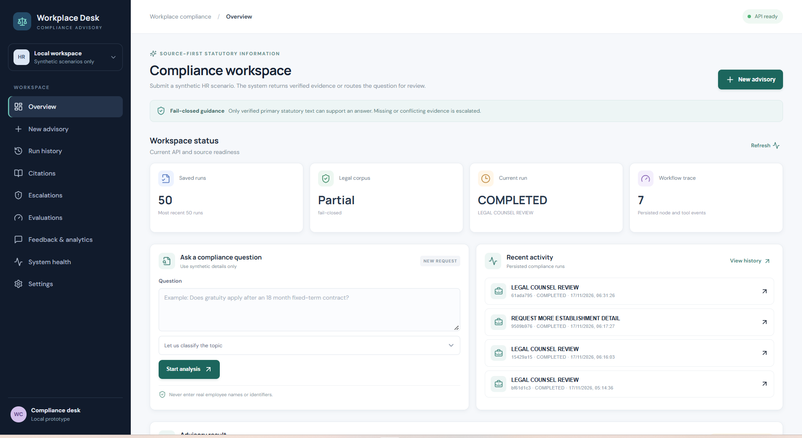
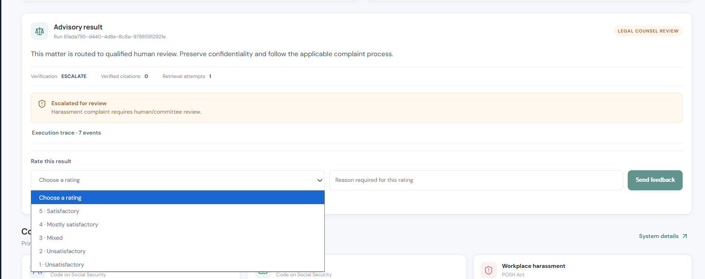
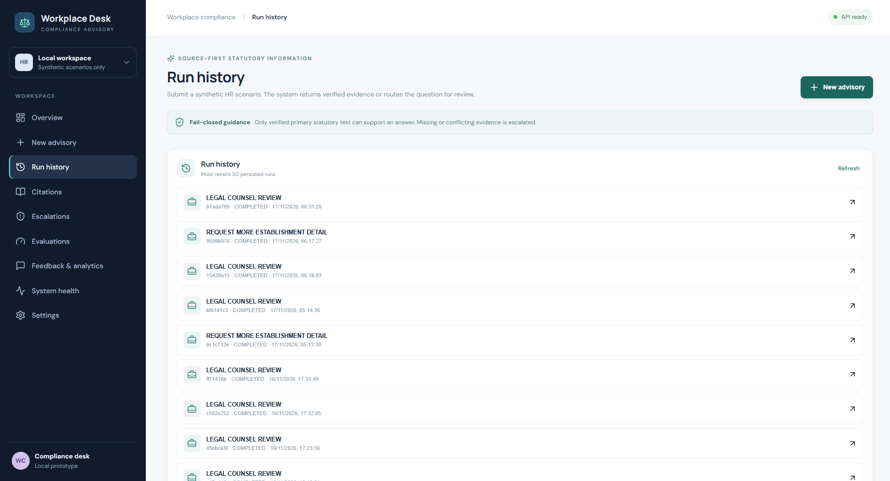
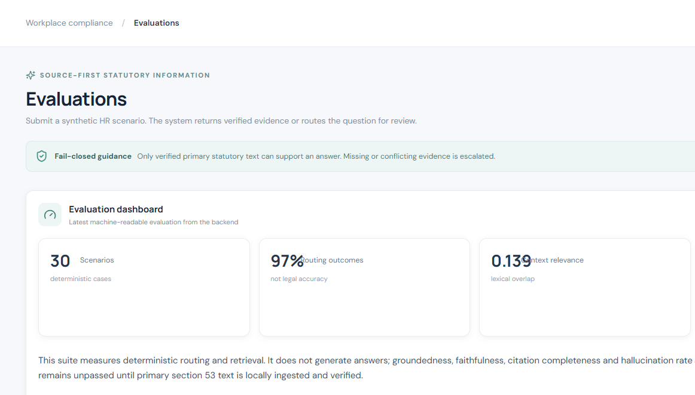
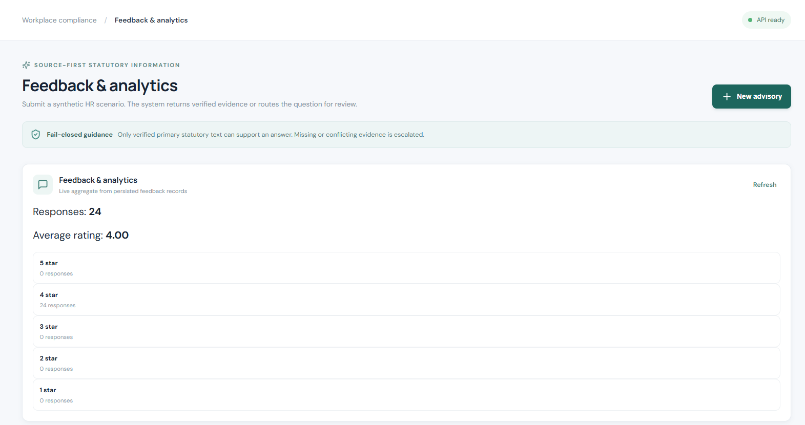
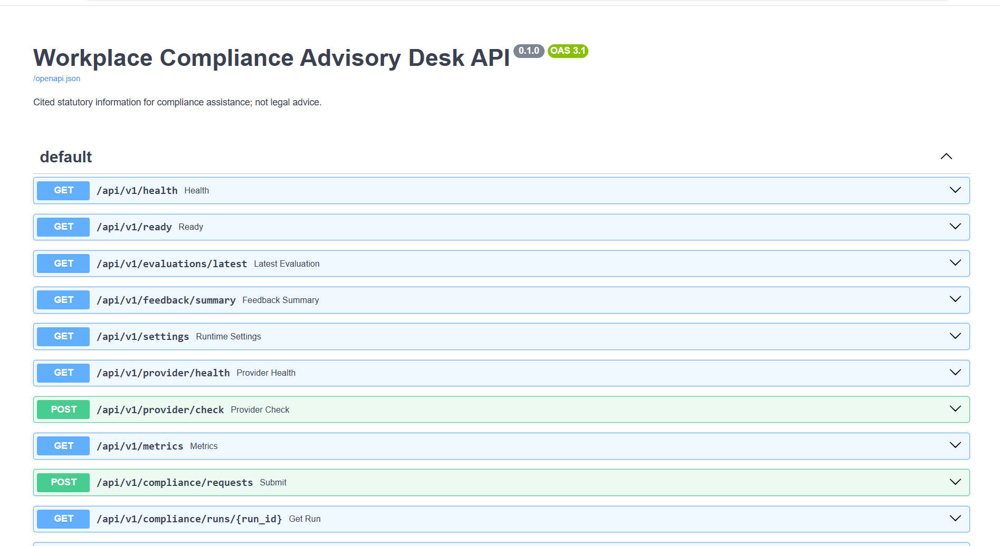
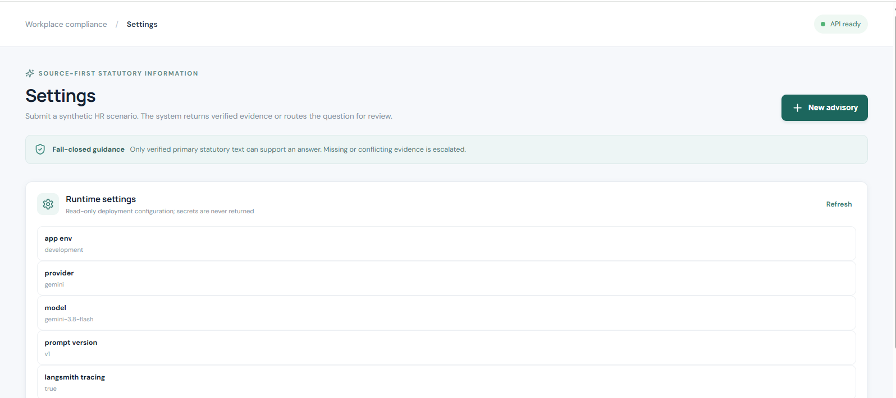
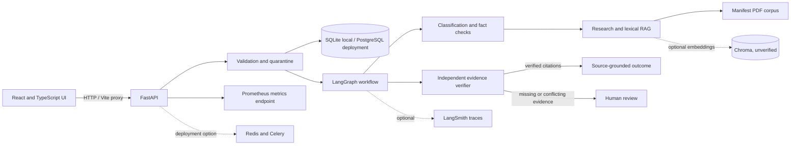
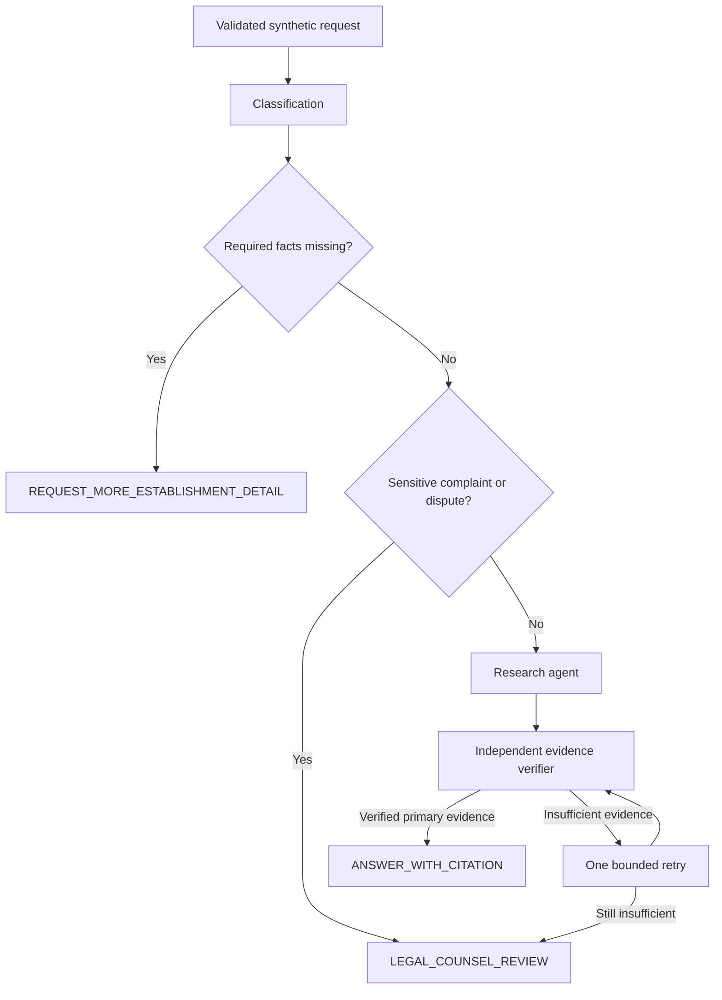
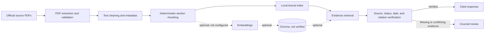

# WorkMitra

### AI-Powered Workplace Compliance Advisory Desk

WorkMitra is a source-first prototype for exploring Indian workplace compliance questions with synthetic scenarios. It retrieves local legal and government material, checks whether evidence is sufficient, and routes unresolved or sensitive matters for human review. It is a decision-support demonstration, not legal advice.

> **Fail-closed by design:** only verified primary statutory text can support a statutory answer. Missing or conflicting evidence is escalated. Use synthetic details only; never enter real employee names or identifiers.

## Why WorkMitra

Workplace questions often depend on establishment details, employment facts, applicable dates, and the exact law in force. WorkMitra makes those dependencies visible: it asks for missing facts, records its workflow, displays source citations when verified, and routes sensitive or unsupported questions for review instead of inventing a legal conclusion.

## What it demonstrates

- A React workspace for submitting requests and reviewing results, run history, citations, escalations, evaluations, feedback, and runtime settings.
- A FastAPI service with request validation, persistent run/event records, health and readiness endpoints, and provider status checks.
- A LangGraph workflow with classification, fact checks, research, citation verification, bounded retry, and outcome routing.
- Local manifest-driven PDF ingestion, deterministic lexical retrieval, source/status/effective-date checks, and optional Chroma-backed semantic retrieval.
- Gemini as an optional configured provider and LangSmith tracing integration. In the latest runtime verification, Gemini timed out (`DEADLINE_EXCEEDED`); no mock fallback occurred. A synthetic application trace was found in the configured LangSmith project.
- SQLite/local background execution for the verified developer setup. PostgreSQL, Redis/Celery, Chroma, and monitoring are optional Compose deployment paths and were not runtime-verified in the latest check.

## Screenshots

| Workspace | Workflow and evidence |
|---|---|
|  **Overview dashboard** |  **Escalated advisory result** |
|  **Run history** |  **Evaluation dashboard** |
|  **Feedback and analytics** |  **API documentation** |
|  **Runtime settings** | |

Screenshots are visual examples, not claims of current backend/provider readiness. See the [full screenshot gallery](docs/screenshots.md) for context.

## Architecture



The full current-state description is in [architecture](docs/architecture.md) and [RAG pipeline](docs/rag-pipeline.md).
## Proposed solution and multi-agent workflow

WorkMitra connects a synthetic request to a multi-step research and verification workflow. Classification and fact checks run first. Research searches local sources; an independent verifier checks source authority, exact passage, legal status, dates, and citation provenance. Research and verification are LangGraph nodes/classes in one process, not separately deployed services. The router returns `ANSWER_WITH_CITATION`, `REQUEST_MORE_ESTABLISHMENT_DETAIL`, or `LEGAL_COUNSEL_REVIEW`. Gemini can suggest a bounded search phrase only; it does not decide legal outcomes.



## RAG pipeline



The available corpus is incomplete and retrieval evaluation is weak. Optional vector components shown above are not claimed as deployed or operational.

## Technology

- **Frontend:** React 18, TypeScript, Vite, Tailwind CSS, Recharts
- **API and workflow:** Python 3.11+, FastAPI, Pydantic, SQLAlchemy, LangGraph
- **Retrieval:** `pypdf`, local lexical search; optional LangChain Chroma and Sentence Transformers
- **Providers/observability:** optional Gemini and LangSmith; Prometheus metrics endpoint; optional OpenTelemetry packages
- **Persistence and deployment options:** SQLite locally; PostgreSQL and Redis/Celery in Compose configuration

## Run locally on Windows

Requirements: Python 3.11+, Node.js/npm, and PowerShell. From the project root:

```powershell
python -m venv .venv
.\.venv\Scripts\Activate.ps1
python -m pip install -r requirements-dev.txt
Set-Location frontend
npm.cmd ci
Set-Location ..
Copy-Item .env.example .env
```

Edit `.env` locally if needed. The example uses offline mock mode. To configure Gemini, provide `LLM_PROVIDER=gemini`, `GOOGLE_MODEL`, and `GOOGLE_API_KEY`. LangSmith tracing can be enabled with `LANGCHAIN_TRACING_V2=true`, `LANGCHAIN_API_KEY`, and `LANGCHAIN_PROJECT`. Do not commit `.env` or paste credentials into issues.

Start both local servers from the repository root:

```powershell
Set-ExecutionPolicy -Scope Process -ExecutionPolicy RemoteSigned -Force
.\scripts\start-local.ps1
.\scripts\check-health.ps1
```

Open [WorkMitra](http://127.0.0.1:5173) and [API docs](http://127.0.0.1:8000/docs). Stop processes started by the script with:

```powershell
.\scripts\stop-local.ps1
```

Alternatively, start the API and UI in separate terminals using `python -m uvicorn backend.main:app --host 127.0.0.1 --port 8000` and `cd frontend; npm.cmd run dev -- --host 127.0.0.1 --port 5173`.

## Legal corpus and important limitation

Run the source manifest check:

```powershell
python -m backend.rag.cli --check
python -m backend.rag.cli --verify-sources --duplicates
```

Latest verified corpus state: **6 manifest entries; 3 locally validated sources; 3 missing primary-law PDFs; 58 chunks; no extraction failures**. The missing documents are the Code on Social Security, POSH Act, and historical Payment of Gratuity Act. Consequently, the fixed-term gratuity scenario must route to legal counsel; WorkMitra does not hardcode an eligibility conclusion. Semantic embeddings/vector retrieval are not configured. Read [legal source register](docs/legal-sources.md) and [known limitations](docs/known-limitations.md).

## Checks and evaluation

```powershell
.\scripts\run-tests.ps1
python -m backend.evaluation.run_eval
```

Latest recorded checks: **47 backend tests passed**, Ruff lint and format checks passed, Python compilation and dependency checks passed, and the frontend production build passed. Unit tests use the separate verified test-only Gazette fixture under `backend/tests/fixtures/`; they do not rely on ignored production `corpus/ingested/*.jsonl`, provider keys, or Docker. The fixture validates only a narrow commencement notification path and does not change the production gratuity escalation. The 30-case deterministic evaluation recorded 29/30 outcome-routing accuracy, 21/28 classification accuracy, 100% escalation/clarification routing correctness, and 0.0 retrieval precision/recall; there were no answer runs, so legal answer accuracy is unmeasured. These metrics measure routing/retrieval behavior, not legal correctness. See [evaluation results](docs/evaluation-results.json), [evaluation report](docs/evaluation-report.md), and [performance report](docs/performance-report.md).

## API overview

- `GET /api/v1/health`, `/api/v1/ready`, `/api/v1/metrics`
- `GET /api/v1/provider/health`; `POST /api/v1/provider/check`
- `POST /api/v1/compliance/requests`
- `GET /api/v1/compliance/runs/{run_id}` and `/trace`
- `GET /api/v1/evaluations/latest`, `/api/v1/feedback/summary`, and runtime settings endpoints

Interactive OpenAPI documentation is served at `/docs`.

## Security and scope

This is a local demonstration prototype. It has no user authentication or authorization and must not be exposed as a public service. Use synthetic scenarios only. Read [security notes](docs/security.md), [deployment guidance](docs/deployment.md), and [troubleshooting](docs/troubleshooting.md) before operating it.

## Documentation

- [Architecture](docs/architecture.md) · [RAG pipeline](docs/rag-pipeline.md) · [Legal sources](docs/legal-sources.md)
- [Local runbook](docs/runbook.md) · [Testing guide](docs/testing-guide.md) · [Troubleshooting](docs/troubleshooting.md)
- [Final acceptance report](docs/FINAL_ACCEPTANCE_REPORT.md) · [Completion plan](docs/FINAL_COMPLETION_PLAN.md) · [Development progress](DEVELOPMENT_PROGRESS.md)
- [Demo script](docs/FINAL_DEMO_SCRIPT.md) · [Viva preparation](docs/viva-preparation.md) · [Screenshots](docs/screenshots.md)

## Future scope

Priority follow-up includes obtaining and locally verifying the missing primary Acts, improving retrieval quality, resolving Gemini connectivity, validating the workflow against authoritative sources, and adding authentication, privacy controls, and deployment hardening before broader use.
