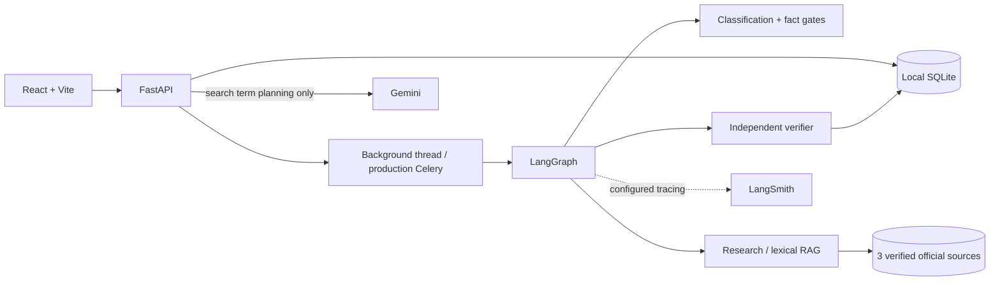

# Final Completion Plan and Verification Status

**Updated:** 2026-11-16
**Workspace:** `C:\SEM 5\MLOPs-Mini Project`

This plan records the latest runtime verification. Older reports describing a live Docker Compose stack or 20-case evaluation are superseded by the current evidence in [`FINAL_ACCEPTANCE_REPORT.md`](FINAL_ACCEPTANCE_REPORT.md).

## Current system flow

React/Vite submits to FastAPI. FastAPI validates/quarantines requests and persists them in SQLite for local development. A local background thread runs a LangGraph workflow; production configuration can use Celery/Redis. The graph classifies the request, checks for missing facts, retrieves official corpus passages, verifies provenance/effective dates/citations, retries once, and either returns a supported result or escalates. Gemini can plan search terms but does not author legal conclusions. LangSmith tracing is explicitly attached to graph execution when enabled.



## Acceptance matrix

| Work item | Latest evidence | Status |
|---|---|---|
| Startup/health scripts | Start script launched API/UI; health and docs returned 200; Vite proxy returned backend readiness JSON | Pass |
| Safe shutdown | Stop script stopped only matched PID/path/start-time; ports 8000/5173 released | Pass |
| Gemini | Real request attempted; gRPC `_InactiveRpcError`, `DEADLINE_EXCEEDED`; no response | Blocked |
| No silent provider fallback | Health reported Gemini; mock mode inactive during failed request | Pass |
| LangSmith | Synthetic app request found in configured project after explicit trace context; 6 matching root/child entries | Pass for tested request |
| Workflow routing | Maternity clarification, POSH human review, gratuity escalation, unsupported-section escalation, injection quarantine | Pass for tested safe routes |
| Narrow Gazette answer | Broad date wording returned counsel review with no verified citation | Partial; retrieval phrasing/coverage gap |
| Fixed-term gratuity | 18-month case escalated with 0 verified citations | Correct safe behavior; required answer scenario blocked |
| Corpus | 3 of 6 sources, 58 chunks; missing primary law documents; checksums match for local PDFs | Partial / blocked |
| Vector retrieval | No embedding model; CLI reports unavailable | Not configured |
| Backend tests | 43 passed, one upstream deprecation warning | Pass |
| Ruff / compile / dependency consistency | Lint, format, compile, pip check passed | Pass |
| Frontend production build | `npm.cmd run build` passed | Pass |
| Deterministic evaluation | 30 scenarios; outcome 29/30, classification 21/28; answer-quality denominator 0 | Partial; no generated answer quality claim |
| Local load profile | 20 users / 30 seconds / stub + SQLite; 1,321 HTTP requests and zero reported request failures | Pass for local stub profile only |
| Docker services | Docker named pipe absent; daemon/config unavailable | Not tested |
| Visual browser QA | Browser access host unavailable; HTTP delivery/proxy checked | Not tested visually |

## Highest-priority follow-up

1. Resolve why the Gemini call reaches `DEADLINE_EXCEEDED`; then repeat `/api/v1/provider/check` and confirm a non-empty model response. Keep provider/model errors sanitized.
2. Acquire, validate, and ingest the official Code on Social Security, POSH Act, and historical Payment of Gratuity Act source PDFs. Do not change the fixed-term gratuity escalation before primary section 53 text and citation tests pass.
3. Improve retrieval for commencement questions, then rerun the actual broad Gazette request and the labeled retrieval suite. The current broad wording did not retrieve a verifying Gazette passage.
4. Configure an embedding model and Chroma only when dependencies/services are available; validate collection contents before claiming semantic retrieval.
5. Run Compose-specific health, migration, worker, and monitoring checks when Docker is available.
6. Perform browser-based visual smoke checks when the browser automation host is available.

## Verified local commands

```powershell
Set-ExecutionPolicy -Scope Process -ExecutionPolicy RemoteSigned -Force
.\scripts\start-local.ps1
.\scripts\check-health.ps1
.\scripts\run-tests.ps1
python -m backend.rag.cli --check
python -m backend.evaluation.run_eval
.\scripts\stop-local.ps1
```

The startup command uses the configured `.env` provider; in this workspace that is Gemini. The provider probe currently fails with a deadline error. The separate Locust profile sets `LLM_PROVIDER=stub`, disables tracing, and uses an isolated SQLite database; its CSVs are stored under `docs/performance-live-stub-2026-11-16*`.
