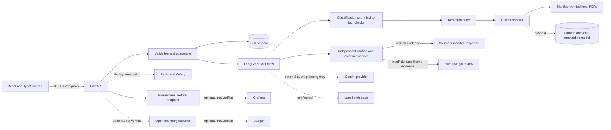
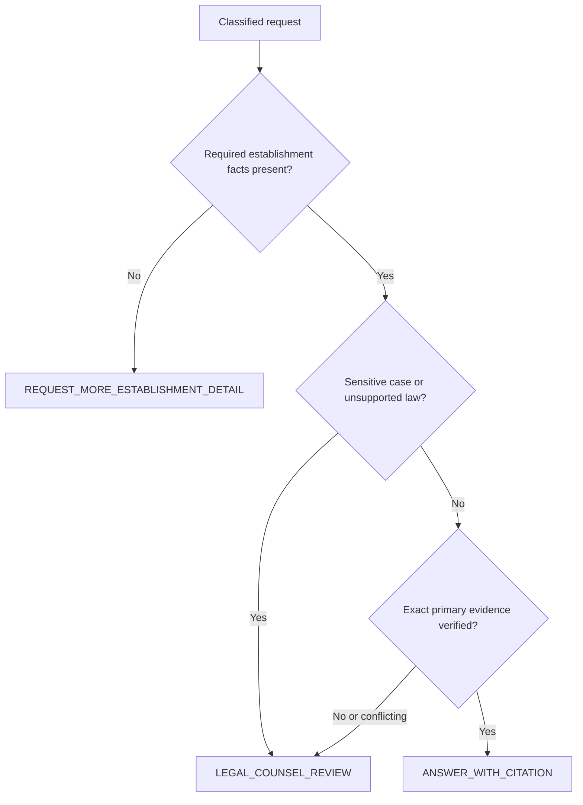

# Architecture

## Current local workflow

Locally, the API uses SQLite and a background thread. The workflow includes request classification, fact sufficiency checks, research, citation/source/date validation, a bounded retry, and safe outcome routing. Prompt-injection-like input is quarantined before workflow execution. Runs and workflow events persist in SQLite.

Gemini is configured as an optional provider for query planning; it does not decide legal conclusions. In the latest verification it timed out with `DEADLINE_EXCEEDED`, and the application stayed in Gemini mode without silently falling back to mock. LangSmith was enabled; a synthetic application request was found in the configured project.

## Configured deployment path

The Compose configuration includes PostgreSQL, Redis/Celery, frontend/API, Chroma and monitoring services. These services were not runtime-verified in the latest environment because Docker Engine was unavailable. Chroma/embeddings and OpenTelemetry export are optional and not claimed as operational. SQLite is the verified local persistence path.

## Evidence and current limits

The local source manifest has six entries: three validated PDFs and 58 extracted chunks, with three primary legal PDFs missing (Code on Social Security, POSH Act, and historical Payment of Gratuity Act). The independent verifier fails closed; the fixed-term gratuity scenario routes to counsel while primary statutory evidence is absent. See [legal sources](legal-sources.md), [RAG pipeline](rag-pipeline.md), and [final acceptance report](FINAL_ACCEPTANCE_REPORT.md).

## Outcome routing

The request layer quarantines unsafe or identifier-like input before workflow execution. SQLite/PostgreSQL records describe local/deployment paths; SQLite is the persistence path verified in the latest local runtime check.
