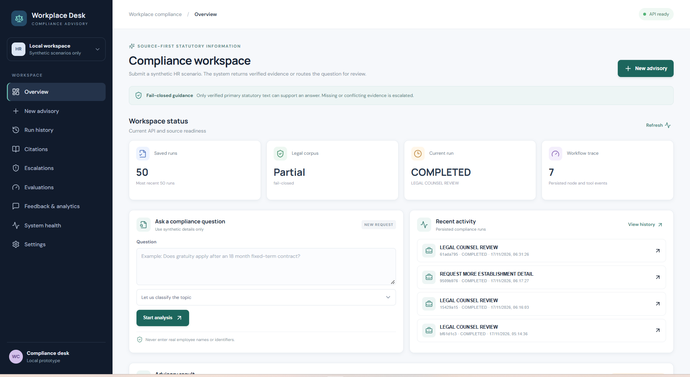
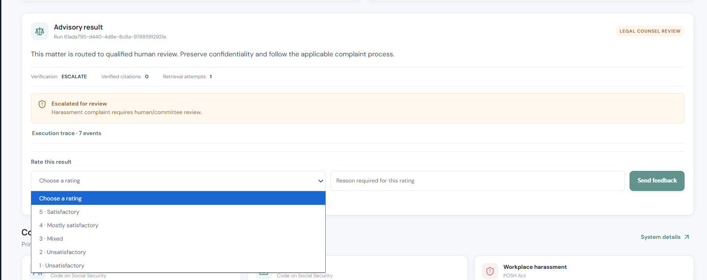
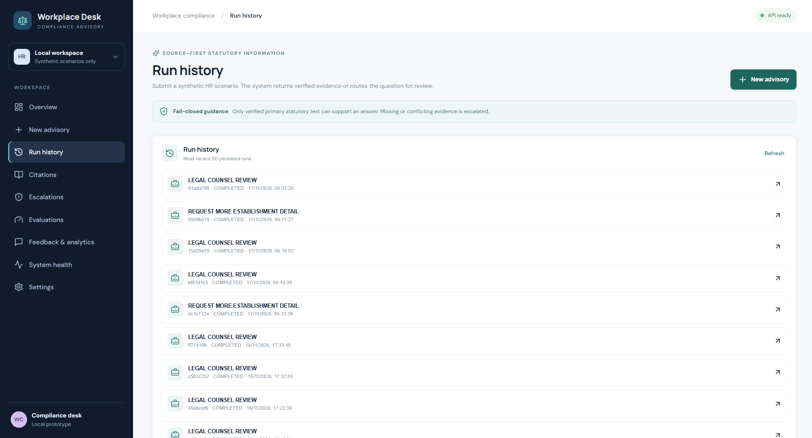
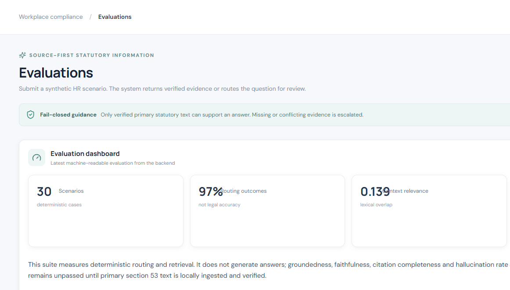
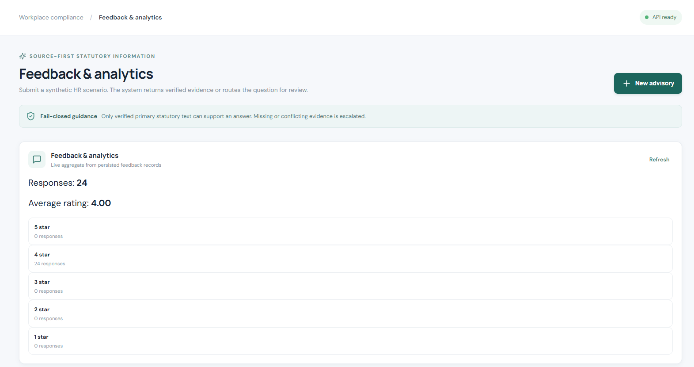
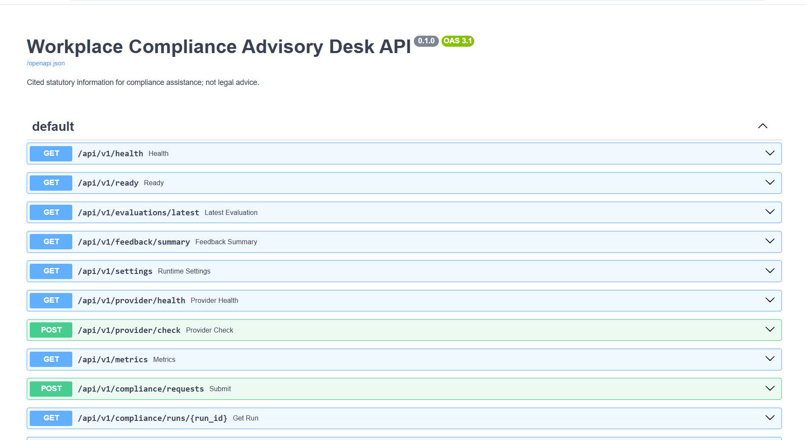
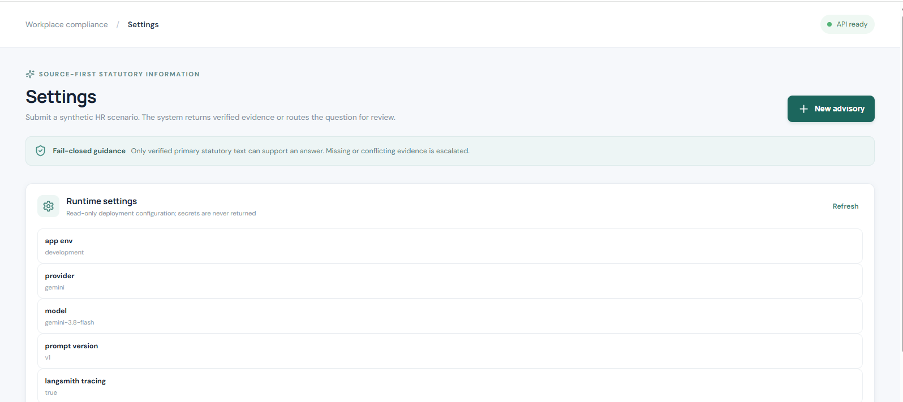

# Screenshots

These screenshots were supplied for the WorkMitra project demonstration. They show the local prototype UI and are included as visual examples; they do not establish current backend, provider, corpus, or legal-answer readiness.

## Overview dashboard

The screenshot shows 50 saved runs, a partial legal corpus, a completed counsel-review result, and seven workflow events. The displayed counts are captured UI data, not the latest runtime test counts.

## Advisory result

This is an example of fail-closed escalation for a harassment complaint requiring human/committee review.

## Run history

## Evaluations

The UI labels 97% as routing outcomes and explicitly says it is not legal accuracy. The latest machine-readable run currently records 29/30 outcome accuracy.

## Feedback and analytics

## API documentation

## Runtime settings

Secrets are not displayed in the runtime settings view.
